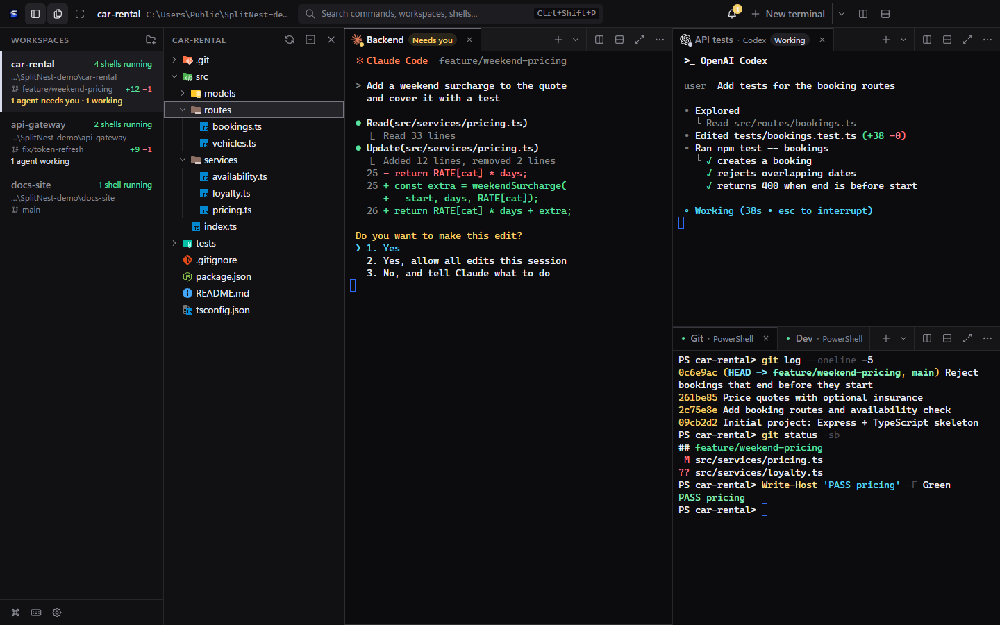
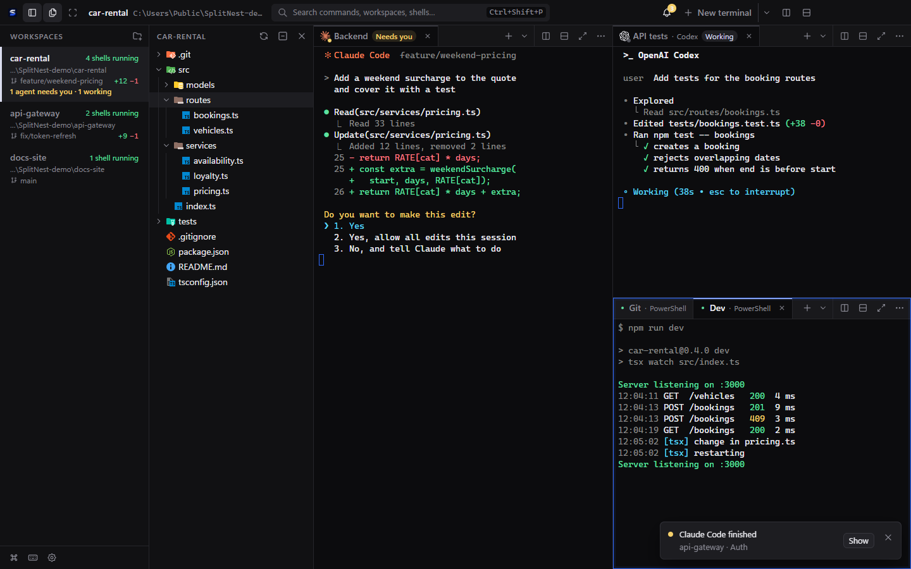
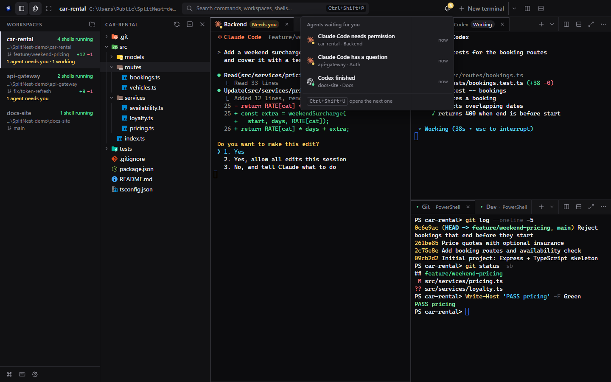
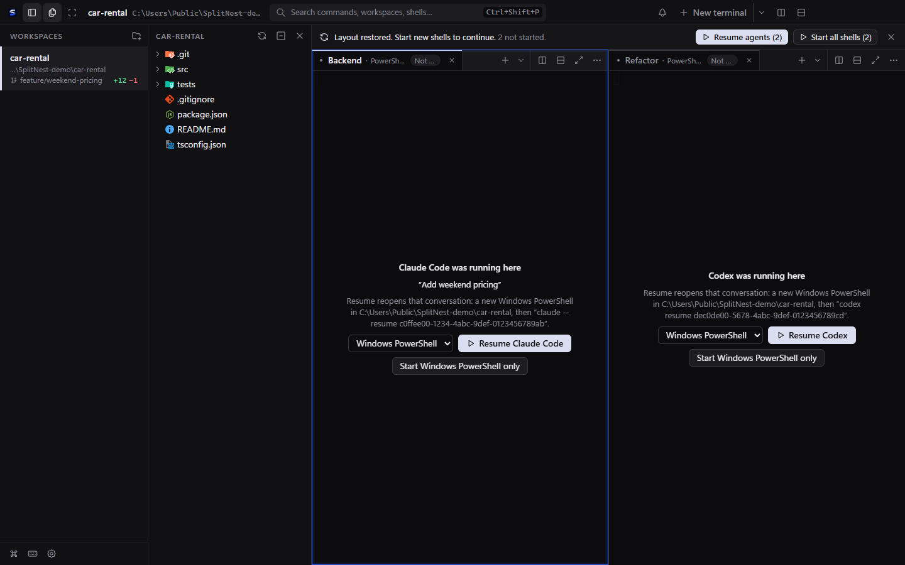
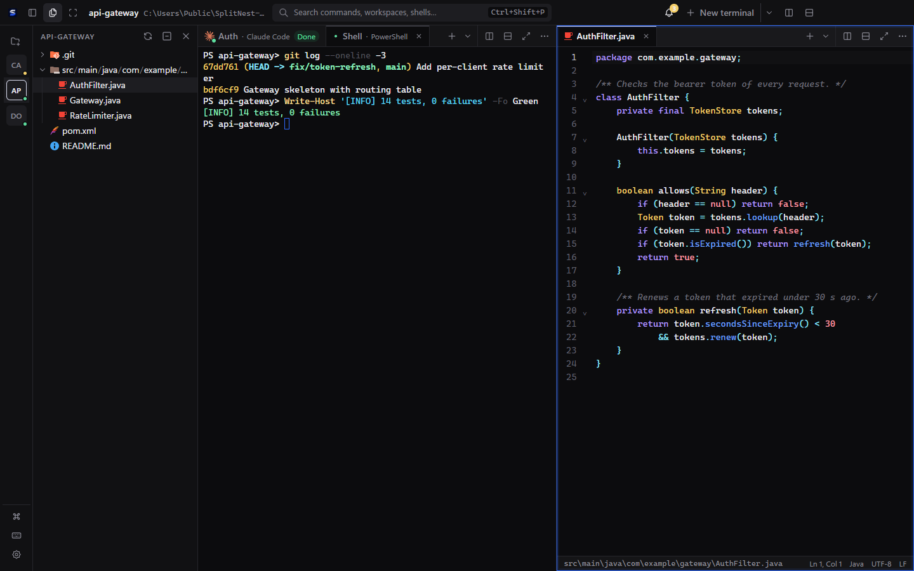
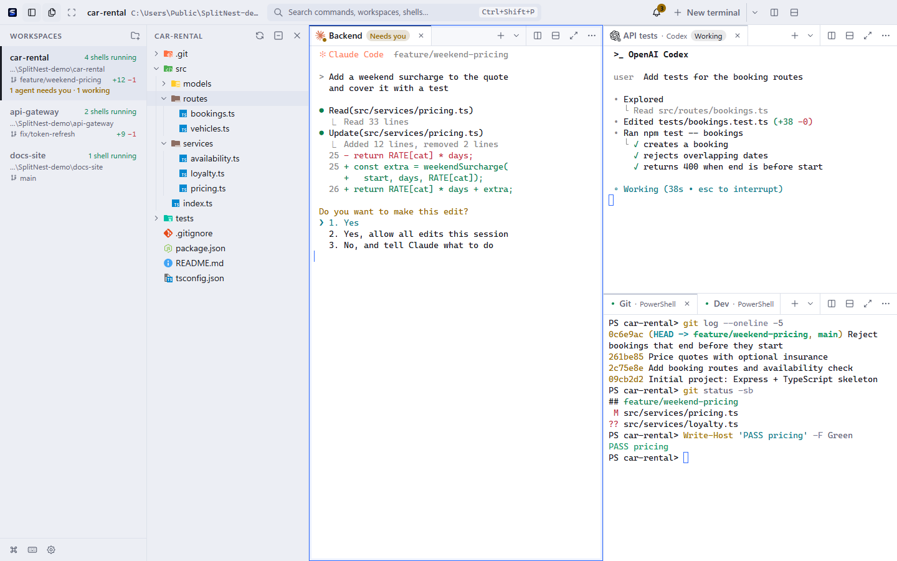
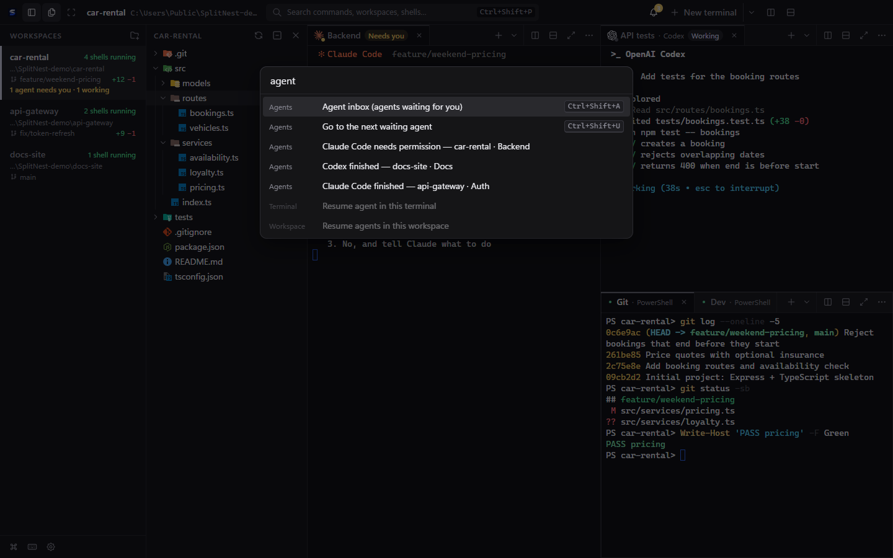

# SplitNest

**The Windows terminal workspace built for AI coding agents.**

  

Open your project folders as workspaces, run real **PowerShell** and **WSL** shells in resizable split panes, and switch between projects without stopping a single session. When Claude Code, Codex or Gemini CLI runs in a tab, SplitNest shows what it is doing, tells you when it needs you, and brings the conversation back after a restart.

> **Status: MVP prototype.** It works for daily use on the machine it was tested on, but it is not production-ready, the build is unsigned, and only Windows 11 x64 has been tested. See [Status and limitations](#status-and-limitations).



## Why SplitNest

- **Agent-aware tabs.** Claude Code, Codex, Gemini CLI, GitHub Copilot CLI, Cursor Agent, Aider, OpenCode, Qwen Code and Amp get their logo and a live state on the tab: *Working*, *Needs you*, *Done* or *Error*.
- **Never miss a prompt.** In-app notices, Windows notifications and a taskbar flash tell you when an agent needs a permission, asks a question, finishes or fails.
- **One inbox for every agent.** A bell in the title bar lists every waiting agent across all workspaces; one shortcut jumps to the next.
- **Pick up where you left off.** After a restart, terminals that ran Claude Code or Codex offer a **Resume** button for that conversation.
- **Projects, not windows.** Each folder is a workspace with its own layout. Background sessions keep running, and layouts and folders come back after a restart.
- **Everything beside the terminal.** File explorer, a built-in CodeMirror editor, per-workspace Git status, five themes and a command palette.
- **Private by design.** No telemetry, no terminal output or credentials saved, and agent text stays out of notifications unless you opt in.

## Agent-aware tabs

When an agent runs in a tab, the tab shows its logo instead of the status dot, its name and what it is doing. The sidebar sums it up per workspace ("1 agent needs you · 2 working"), and the window title carries a count so it shows in the taskbar.

SplitNest learns about agents three ways: the agent reports its own state (Program Status Protocol, OSC 7501), a hidden helper detects the agent process in PowerShell tabs, and bell or spinner fallbacks for agents that do not report. A reported state is shown solid; a guess is shown dashed with a "?" so you always know which is which. No agent settings or hooks are changed.

## Notifications



When an agent needs you, finishes or stops with an error, SplitNest tells you the way that fits: nothing for the tab you are looking at, an in-app notice with a **Show** button when another tab is in front, and a Windows notification when SplitNest is minimized or behind another program. For "needs you" the taskbar button also flashes. Clicking a notification shows that exact tab.

## Agent inbox



The bell in the title bar (**Ctrl+Shift+A**) lists every agent waiting for you in all workspaces, most urgent first, with the time it has waited. **Ctrl+Shift+U** goes to the next waiting agent, wherever it is. Nothing is saved: the inbox shows what is waiting right now.

## Resume agent conversations



If Claude Code or Codex was running when SplitNest closed, that terminal says so after a restart and offers **Resume Claude Code** (or Codex). The text above the button states exactly what will run, and nothing runs until you click. Only the conversation id, folder and an optional title are saved, never conversation text.

## Workspaces, splits and tabs

Each project folder is a workspace in the sidebar with its running-shell count. Split any pane left/right or top/bottom, give tabs names such as *Backend* or *Tests*, drag tabs between panes, maximise a pane, or hide both sidebars with focus mode. Short prompts keep long folder paths from wrapping (`PS car-rental>`) without ever rewriting terminal output.

## File explorer and editor



A file explorer with Material Icon Theme icons sits beside the terminals, with compact folders for deep trees. Click a file to open it in the built-in editor (CodeMirror 6): syntax highlighting for about two dozen languages, find/replace, explicit **Ctrl+S** saving, detection of changes made on disk, and a SHA-256 check before every save so nothing is overwritten silently.

## Git status

Each workspace in a Git repository shows its branch and the lines added and removed since the last commit. SplitNest only reads the repository; it never changes it. Needs Git for Windows on PATH.

## Themes and command palette



Five themes: **Graphite** (default), **Silver Light**, **Midnight Blue**, **Ember** and **Lagoon**, or follow Windows light/dark automatically. **Ctrl+Shift+P** opens a command palette for workspaces, shells, settings and agents.



The full feature reference is in the [user guide](docs/USER_GUIDE.md).

## Getting started

There is **no installer and no release download yet**. Build it from source:

```powershell
npm ci          # install the pinned dependencies (Node.js 20.19+ and npm)
npm start       # run in development
npm run make    # build a ZIP: out/make/zip/win32/x64/SplitNest-win32-x64-0.1.0.zip
```

Extract the ZIP anywhere and run `splitnest.exe` (Node.js is not needed to run it). Click **Open folder…** and choose a project folder; a PowerShell terminal starts there.

The build is not code-signed, so Windows SmartScreen may show an "unrecognized app" prompt. Choose **More info → Run anyway** only if you built it yourself or trust where it came from. Do not turn off Windows security features to run it. See the [code signing policy](CODE_SIGNING.md) for how releases are built and the plan to sign them.

### Requirements

| | |
|---|---|
| OS | Windows 11 x64 (tested on build 26300). Windows 10 1809+ is likely to work but untested. |
| Shells | Windows PowerShell 5.1 (built in). PowerShell 7 (`pwsh.exe`) is used automatically when installed. |
| Git (optional) | Git for Windows (`git.exe` on PATH) for the sidebar's Git status. Without it the rest works and no Git status is shown. |
| WSL (optional) | An installed WSL distribution. The app never installs or configures WSL. To add it yourself, follow Microsoft's WSL documentation (for example `wsl --install` in an administrator terminal), then use **Settings → Refresh shell list**. |
| Development | Node.js 20.19+ (tested with 20.19.5) and npm. No compiler is needed: node-pty 1.1.0 ships N-API prebuilds. |

The app was previously called "Terminal Workspace"; on first start SplitNest copies saved workspaces from `%APPDATA%\Terminal Workspace\` (the old file is left untouched). The name is defined in [`src/shared/product.ts`](src/shared/product.ts) plus `productName` in `package.json`.

## Keyboard shortcuts

Also listed in the app (**Ctrl+Shift+/**). Plain Ctrl+letter keys always go to the shell.

| Action | Keys |
|---|---|
| Command palette | Ctrl+Shift+P |
| New workspace from folder | Ctrl+Shift+O |
| New terminal in the current pane | Ctrl+Shift+T |
| Next / previous terminal in the pane | Ctrl+Tab / Ctrl+Shift+Tab |
| Split left/right / split top/bottom | Ctrl+Shift+D / Ctrl+Shift+S |
| Close terminal (last one closes the pane) | Ctrl+Shift+W |
| Rename terminal (on a focused tab) | F2 |
| Find in terminal | Ctrl+Shift+F (Enter / Shift+Enter: next / previous, Esc: close) |
| Start / restart shell | Ctrl+Shift+R |
| Move focus between panes | Ctrl+Alt+Arrow keys |
| Next / previous workspace | Ctrl+Shift+PgDn / Ctrl+Shift+PgUp |
| Collapse / expand workspace sidebar | Ctrl+Shift+B |
| Show / hide file explorer | Ctrl+Shift+E |
| Focus terminals (hide / restore both sidebars) | Ctrl+Shift+Enter |
| Maximise pane / restore layout | Ctrl+Shift+M |
| Font size bigger / smaller / reset | Ctrl+= / Ctrl+− / Ctrl+0 |
| Agent inbox / next waiting agent | Ctrl+Shift+A / Ctrl+Shift+U |
| Settings | Ctrl+, |
| Keyboard shortcut list | Ctrl+Shift+/ |
| Copy | Ctrl+C **when text is selected** (otherwise Ctrl+C interrupts), or Ctrl+Shift+C |
| Paste | Ctrl+V or Ctrl+Shift+V; right-click pastes when nothing is selected, copies otherwise |

App shortcuts are a fixed table (no user configuration yet). Notes on Ctrl+Shift+M and shortcut scope are in the [user guide](docs/USER_GUIDE.md#keyboard-shortcuts).

## Privacy

- **No telemetry.** SplitNest contains no analytics or telemetry. Links in terminal output open in your browser only on Ctrl+click, and only for `http`/`https`.
- **Update checks (since version 0.2.0).** The installed app checks for updates by default: it explains this when it first starts, before any check, and it can be turned off in Settings → About. The portable ZIP never checks. The check sends the app version, platform and architecture (plus what any HTTPS request reveals, such as your IP address) to GitHub only (this project's GitHub Releases). Details: [privacy policy](https://splitnest.dev/privacy/).
- **Saved** (`%APPDATA%\SplitNest\workspace-state.json`): workspace names and folders, pane layouts, each terminal's shell and optional custom name, the agent conversation running in it (agent, conversation id, folder, and optionally its title), and appearance settings.
- **Never saved:** terminal output, command history, environment variables, credentials, or the contents of files open in the editor (only their workspace-relative paths). The log records lifecycle events and errors only, never terminal input or output.
- **Agent text is off by default in notifications and the inbox.** A session title or message can contain your prompt, so it is shown only if you turn on *Include what the agent wrote*.
- **Resume titles are on by default.** The conversation title shown above the Resume button can contain words from your prompt; turn it off in Settings → Workspaces → *Show conversation titles for Resume* and the saved ones are removed.
- Agent process detection runs in the main process; command lines never leave it and are not logged.

Details on restoring, cleanup and troubleshooting are in the [user guide](docs/USER_GUIDE.md#saved-state-and-restoration).

## Status and limitations

SplitNest is an **MVP prototype**. It is not production-ready.

- Windows 11 x64 only; builds are **unsigned** (Windows SmartScreen may warn; see the [code signing policy](CODE_SIGNING.md)). Since version 0.2.0 there is an installer with automatic updates; see [CHANGELOG.md](CHANGELOG.md).
- The displayed directory is where the shell **started**; there is no shell integration that tracks `cd`.
- Full-screen programs work, but ConPTY repaints them itself, so their screens can leave frames in the scrollback.
- WSL tabs cannot use process detection, so they rely on the agent's own status reports; Resume there opens the agent's own conversation list rather than a specific conversation.
- Display scaling, Windows 10 and PowerShell 7 are untested.
- Scrollback is per pane and lives only in memory.

The full list, with test results and measurements, is in [docs/TESTING.md](docs/TESTING.md#known-limitations-and-remaining-verification) and the [user guide](docs/USER_GUIDE.md#known-limitations).

## Development

```powershell
npm ci                 # install the pinned dependency set (package-lock.json)
npm start              # run in development (Vite dev server + Electron)
npm run lint
npm run typecheck
npm test               # unit + real PowerShell PTY + WSL tests (WSL tests skip if no distribution)
npm run test:unit      # pure logic only
npm run test:pty       # real ConPTY sessions with Windows PowerShell
npm run test:wsl       # requires an installed WSL distribution
npm run package        # -> out/SplitNest-win32-x64/
npm run verify:package # checks unpacked native files and runs the packaged headless self-test
npm run test:e2e       # drives the built app UI with Playwright (run `npm run package` first)
npm run smoke:packaged # launches the packaged exe, screenshot, startup time, memory, forced-kill cleanup
npm run make           # -> out/make/zip/win32/x64/*.zip
npm run licenses       # regenerate THIRD_PARTY_LICENSES.md
npm run icons          # re-copy the file-icon subset after editing src/renderer/features/explorer/icon-map.json
npm run ui-icons       # regenerate the UI icons (Tabler Icons subset) after editing scripts/ui-icons.mjs
```

Tests and the E2E script use temporary folders and a separate user-data folder, so they don't touch your saved workspaces. The README screenshots are regenerated by `scripts/readme-screenshots.mjs` (see the comment at its top); it works on invented demo projects only.

Documentation: [user guide](docs/USER_GUIDE.md) · [architecture](docs/ARCHITECTURE.md) (processes, IPC and security boundaries) · [testing](docs/TESTING.md) · [plan](docs/PLAN.md)

## Code signing policy

Windows releases are **not code signed yet**; the project intends to apply to the SignPath Foundation for free code signing for open-source projects. How releases are built, who approves signing, what would be signed and how to verify a download: [code signing policy](CODE_SIGNING.md) (also on [splitnest.dev](https://splitnest.dev/code-signing/)). Security reports: [SECURITY.md](SECURITY.md).

## License

MIT, see [LICENSE](LICENSE). Third-party dependencies and their licenses are listed in [THIRD_PARTY_LICENSES.md](THIRD_PARTY_LICENSES.md). Agent logos come from [developer-icons](https://github.com/xandemon/developer-icons) (MIT) and are trademarks of their owners; UI icons are [Tabler Icons](https://github.com/tabler/tabler-icons) (MIT); file icons are [Material Icon Theme](https://github.com/material-extensions/vscode-material-icon-theme) (MIT).
